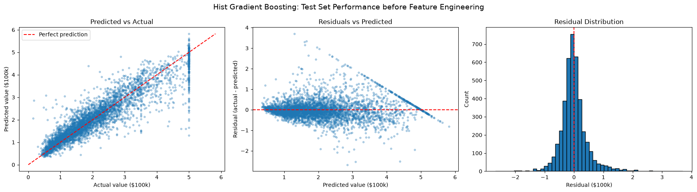
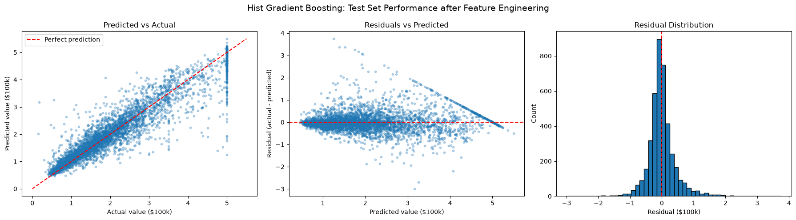

# California Housing Price Prediction

Predicting median house values for California census block groups with scikit-learn. The project compares linear and tree-based regressors, tunes the best one with randomized search and 10-fold cross-validation, and tests whether engineered geographic features improve it using a paired fold-by-fold comparison. The final model is a histogram gradient boosting regressor with a test RMSE of about **$45.5k**, compared with about **$116k** for a mean-prediction baseline.

| Before feature engineering | After feature engineering |
|---|---|
|  |  |

## Results

All numbers below are on a **held-out test set of 4,128 block groups** that was not used for tuning or feature decisions. The target is in units of $100k, so an RMSE of 0.455 is about $45.5k.

| Model | Test RMSE | Approx. error |
|---|---|---|
| Mean-prediction baseline (`DummyRegressor`) | 1.161 | $116k |
| Hist gradient boosting, original features | 0.472 | $47.2k |
| **Hist gradient boosting + engineered features** | **0.455** | **$45.5k** |

Final model on the test set: **MAE 0.295 ($29.5k)**, **R² 0.846**, and RMSE of 0.417 ($41.7k) when the 5.1% of rows capped at $500k are excluded.

### Did the engineered features help?

Yes, by a small but consistent amount. I tuned the model separately with and without the features, then compared the two on the **same 10 cross-validation folds** (training data only):

- Mean RMSE gain: **0.0139 ± 0.0014** (standard error)
- Folds improved: **10 of 10**
- Test RMSE: 0.472 to 0.455 (about 3.6% lower), consistent with the cross-validation result

### Model selection (exploratory)

Before tuning, I compared several models at default settings with cross-validation. These scores come from earlier exploratory runs, so they are not directly comparable to the test numbers above.

| Stage | CV RMSE |
|---|---|
| Mean baseline | 1.154 |
| Ridge regression | 0.729 |
| Random forest (default) | 0.503 |
| Gradient boosting (default) | 0.533 |
| Random forest (tuned) | 0.499 |
| Hist gradient boosting (tuned) | 0.468 |

Both tree ensembles beat Ridge by a wide margin, which shows the relationship between the features and price is strongly nonlinear. Tuning barely moved the random forest but helped boosting substantially, so histogram gradient boosting became the final model.

## Key findings

- **Nonlinearity matters.** Tree ensembles cut error by roughly a third compared with Ridge.
- **The target is capped at $500k.** 5.1% of test rows share the same maximum value, which produces the vertical column in the predicted-vs-actual plot and the diagonal streak in the residual plot. These rows contribute roughly a fifth of the total squared error, and no feature can fix them because the real values were never recorded.
- **Errors grow with price.** The residual plot widens at higher predicted values, so the single RMSE hides the fact that cheap areas are predicted more accurately than expensive ones.
- **Feature engineering gave a modest, verified gain**, and it left the structural problems above unchanged.

## Error analysis

The 10 largest test errors, with locations inferred from their coordinates:

- **Eight are under-predictions of expensive areas** (six of them at the $500k cap). Their coordinates correspond roughly to other medium-sized cities, and other places where prices look higher. The model predicted about 1.3 to 2.5 ($130k to $250k) for these rows.
- **Two are over-predictions** in big city areas, where the recorded values are unusually low (0.55 and 0.175, i.e. $55k and $17.5k) and the model's location features pushed predictions up.
- **One of the worst rows has median income exactly at the dataset's minimum (0.4999)**, which suggests the income feature is also floored or capped.

Likely explanation (a hypothesis, not tested): median income does not capture wealth, and the features contain no information about proximity to the coast, lakes, or universities, or about vacation and retirement markets. Distance to the coast and similar location features would be the next thing to try.

## Approach

**1. Data and split**
- scikit-learn's California housing dataset: 20,640 block groups, 8 numeric features, target is median house value in units of $100k. The data comes from the 1990 census, so the dollar values are not current prices.
- 80/20 train/test split (`random_state=2`). The test set is used once, for final evaluation.

**2. Baseline and model comparison**
- A mean-prediction `DummyRegressor` sets the baseline to beat.
- Ridge, random forest, and gradient boosting were compared with cross-validated RMSE.

**3. Hyperparameter tuning**
- `RandomizedSearchCV` with 100 sampled combinations, 10-fold `KFold` (shuffled, seeded), scored by RMSE, run on the training data only.
- Final parameters: `max_iter=500`, `learning_rate=0.15`, `max_depth=5`, `min_samples_leaf=25`, `l2_regularization=0.0`.

**4. Feature engineering (inside the pipeline)**
- Straight-line distance (in degrees of latitude and longitude) from each block group to San Francisco, Los Angeles, San Diego, San Jose, and Sacramento, plus the minimum of those five.
- Bedroom ratio (`AveBedrms / AveRooms`) and log of population.
- Implemented as a `FunctionTransformer` step in a scikit-learn `Pipeline`, so training and test data are treated identically.

**5. Evaluation**
- Paired fold-by-fold comparison on the training data to decide whether the features help.
- A single final evaluation on the test set: RMSE, MAE, R², and RMSE with and without capped rows.
- Predicted-vs-actual, residual-vs-predicted, and residual-distribution plots.

## What I learned

- Pipelines keep preprocessing and feature steps inside cross-validation, which prevents leakage.
- Cross-validation scores that include the test rows are optimistic. I caught this partway through the project and moved all tuning and feature decisions to training data only.
- Comparing two models on identical folds, and counting how many folds improve, is much more informative than comparing two overall averages.
- Looking at where a model fails (the cap, the funnel, specific regions) is as valuable as the headline metric.

## Limitations and next steps

- **Top-coded target.** Values above $500k are recorded as the maximum, which limits achievable accuracy. A censored-data model would be the principled fix.
- **Early comparisons used all rows.** The baseline and the first model comparison were cross-validated on the full dataset, including the test rows. The gaps between models were large, so the model choice is unlikely to change, but the final tuning and feature decisions use training data only, and the test set was used once.
- **No per-feature diff.** I tested the engineered features as a group, so I can't say which ones carry the gain. Some features scould cause certain predictions to vary.
- **Ideas:** distance to the coast and college cities, a better treatment of the capped rows, and a stacked or blended model.